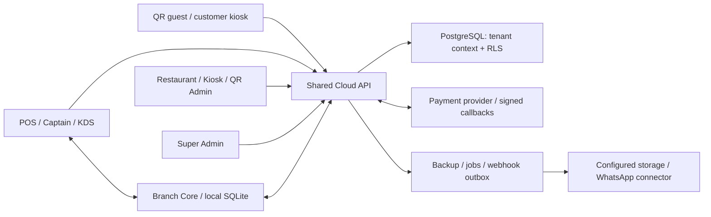

# JAMANVAAR ecosystem assessment — 11 October 2026

## Executive decision

| Independent assessment | Score /10 | Disposition |
| --- | ---: | --- |
| Security | 5.1 | PROVISIONAL; confirmed POS-to-manager escalation blocks release approval |
| Code quality | 6.0 | PROVISIONAL; significant test, type-contract and maintainability gaps |
| SaaS readiness | 5.6 | PROVISIONAL; real multi-branch foundation, incomplete assurance and integration reliability |

**Release recommendation: BLOCKED pending SEC-01 remediation and verification of the remaining release gates.** This is an internal source-and-test assessment, not a certification of the deployed ecosystem. There is no confirmed unauthenticated critical exploit in this assessment; the dependency scanner's critical ratings are a separate category. The independent maintainability dimension is 5/10, included in code quality, not a fourth blended ecosystem score.

The platform contains meaningful controls: separate platform/tenant authentication realms, hashed device credentials, device/branch entitlement enforcement, established database RLS, integer-paise cloud contracts, server-priced QR checkout, verified gateway webhooks, transaction/idempotency mechanisms, replay cursors and encrypted production backup enforcement. These do not close the confirmed authority and data-layer gaps.

Six independent probes reproduce: POS-only manager creation; missing RLS on three tables; pure unknown-state bypass; API persistence of that bypass; default no-proof cancellation; and duplicate webhook dispatch. All six tests pass by **asserting unsafe behavior**. They are reproductions, not successful protection tests.

## Baseline, coverage and limits

- Both audit briefs assessed against commit `a6e13aaf01f19088bc3c2c89b59cf0badd763120` in a detached worktree. Shared live workspace changes were excluded and preserved. No application source fix, production deployment, migration, credential rotation, real payment or external message was performed.
- Frozen lock SHA-256 `57a80ec97fb3ccdca33dd0404fd71894b59f06d77b30a87dffa523094e04e2f0` matches the live workspace lock. Dependencies were reused through a node_modules junction; a fresh `npm ci`, full SBOM comparison of installed contents, and clean native rebuild were NOT performed. This limits reproducibility confidence.
- Initial API runs used the existing isolated QA database. Its migration ledger did not fully match the frozen source (75 recorded migrations versus 83 expected), so a new localhost-only database was created without modifying existing databases. All 83 frozen migrations and the reference seed applied successfully; checksum/name comparison has no missing, extra or mismatched migrations, and the role is non-superuser/non-BYPASSRLS. See FRESH_QA_SCHEMA_BASELINE.json and the fresh repetition log. Older QA results are retained separately.
- Fresh API repetition: **321 passing / 2 failing tests in 22 files**. Both failures are diagnosed test defects: the QR selector (QUAL-03) and the historical webhook error substring (QUAL-07). The corrected QR audit copy passes all 34 scenarios; direct DB verification proves the synthetic unknown-payment callback was correctly persisted as FAILED. All six unsafe-behavior probes still reproduce. These results do not make the original test suite green.
- Inventory: 10,959 tracked files; 21 package manifests; 1,480 scanned source/test/tooling files and 254,448 lines; 72 controller files; 62 Prisma models; 386 test-file paths. These are discovery counts, not endpoint/security coverage percentages.
- The frozen-source code was unchanged. An audit probe and diagnostic test copy were added only to the detached checkout. An additional diagnostic recheck changed only its QR fixture selector. Running the existing asset pretest regenerated public icons/manifests/photos within that checkout; it did not change production code. Tests also regenerate that checkout's historical PERFORMANCE.json. These generated changes are recorded in the baseline evidence.
- Deep review focused on authentication/authority, tenant/branch isolation, synchronization and order/payment state, database migrations, native update/release boundaries, configuration and worker delivery. All applications/packages were inventoried; every route/screen/native binary was **not** exhaustively exercised.
- Overall confidence: moderate. High confidence for the six reproduced paths and executed checks; medium for inspected source; low for live AWS, device hardware, complete UI, binaries and operational recovery.
- Missing tools: cargo-audit, Semgrep, Gitleaks, Trivy and Docker were unavailable. No result from them is claimed. Rust advisories, image CVEs, full history secret scanning and production container verification are NOT TESTED.
- Browser-by-browser CRUD/responsiveness/accessibility, live mobile UPI/app choice, real gateway settlement/refund, production TLS/IAM/security groups/storage ACLs, physical kiosk/LAN attacks, restore of a real backup and native APK installation are NOT TESTED. Prior reports were context, not evidence of execution on this commit.

## Discovered platform and attack surface

The primary trust boundaries are public guest capability/session → server-priced order; human role → device identity; restaurant → branch → device ownership; local offline data → canonical synced orders; payment attempt → verified collection → ledger/report; and authorized release metadata → native executable update. SEC-01 crosses the human/device boundary, SEC-02 weakens tenant query containment, and SEC-03 crosses the lifecycle boundary.

Kiosk Admin is a context in the shared admin source, not an independently located current source application. Older separate Kiosk Admin executables exist locally and were separately inventoried. QR marketing/login/admin and customer ordering are distinct experiences with shared platform services. `packages/branch-core` and `packages/native` have operational/native code even without separate package manifests. No independent Python application, Pydantic/SQLAlchemy backend, Redis service or separate microservice was located; Python discovered here is tooling. Do not infer that every integration in production was present or tested.

## Application scorecards

Scores include inherited shared-backend and release risks. They are not an average of screen quality and are not certifications. Per-application dimension vectors, weights and confidence are in [SCORECARD.json](SCORECARD.json).

| Application | Security /10 | Code quality /10 | SaaS /10 | Coverage / main concern |
| --- | ---: | ---: | ---: | --- |
| Cloud API | 5.1 | 6.0 | 5.6 | High for probed boundaries; medium for remaining source; SEC-01/02/03/04; dependency alerts; worker race |
| Super Admin | 5.6 | 5.9 | 5.6 | Medium; API authorization tested, every screen NOT TESTED; Shared backend controls, oversized onboarding/detail, shared barrel import |
| POS | 4.9 | 5.8 | 5.6 | High for sync/authorization probes; medium for client source; Device-to-manager escalation and missing-proof fallback |
| Restaurant Admin | 5.3 | 5.8 | 5.6 | Medium; backend tests, UI routes NOT TESTED; Staff authority boundary, shared application complexity |
| Kiosk Admin context | 5.3 | 5.7 | 5.6 | Medium; not a separate executable source application; Shares admin backend and release controls |
| QR Admin + public product site | 5.3 | 6.0 | 5.6 | Medium/low; API tested, route-by-route browser review NOT TESTED; Shared admin/backend dependencies; unverified UI workflows |
| QR Customer Ordering | 5.7 | 6.5 | 5.6 | High for selected API payment cases; medium for source; Unknown-state sync bypass downstream; mobile gateways NOT TESTED live |
| Kiosk Customer | 5.5 | 5.8 | 5.6 | Medium; API payment/ownership tested, touchscreen hardware NOT TESTED; 4,214-line app, native update and device storage risk |
| Captain | 5.4 | 6.1 | 5.6 | Medium; API multi-device tests, native/device tests NOT TESTED; Shared order engine and offline release verification |
| KDS | 5.3 | 6.4 | 5.6 | High for status bypass; medium for UI source; SEC-03 permits reopening a cancelled order |
| Branch Core | 5.3 | 6.0 | 5.6 | Medium; selected root tests; physical LAN penetration NOT TESTED; Adjacent credential key, branch sync throughput and release sidecar provenance |
| Legacy local runtime | 4.7 | 5.3 | 4.6 | Low; secondary source inspection; actual production use NOT TESTED; Multiple runtime implementations; avoid shipping unintended legacy path |

All rows are PROVISIONAL. Shared security findings affect multiple consumers and must not be summed as separate vulnerabilities. The scorecard inventories exposure, integrations and source paths for each application. The shared package set is `api`, `business`, `config`, `database`, `i18n`, `sync`, `types`, `ui`, `utils`, `validation`, `tauri-plugin-apk-updater` and kiosk shared code. Their findings are attributed to the consuming products; they are libraries rather than independently deployed applications.

Counts below cover applicable confirmed source/probe findings SEC-01..08 only, including conditional release/configuration findings. They exclude scanner alerts, unversioned artifacts, unproven exploit paths and quality findings. A zero means no directly attributed confirmed finding in this sample, **not a clean bill of health**. All statuses remain PROVISIONAL.

| Application | Critical | High | Medium | Low | Applicable security IDs |
| --- | ---: | ---: | ---: | ---: | --- |
| Cloud API | 0 | 1 | 4 | 0 | SEC-01, SEC-02, SEC-03, SEC-04, SEC-06 |
| Super Admin | 0 | 0 | 0 | 0 | None directly confirmed; limited coverage |
| POS | 0 | 2 | 3 | 0 | SEC-01, SEC-03, SEC-04, SEC-05, SEC-07 |
| Restaurant Admin | 0 | 2 | 3 | 1 | SEC-01, SEC-03, SEC-04, SEC-05, SEC-07, SEC-08 |
| Kiosk Admin context | 0 | 1 | 1 | 1 | SEC-05, SEC-07, SEC-08 |
| QR Admin + public product site | 0 | 0 | 1 | 1 | SEC-03, SEC-08 |
| QR Customer Ordering | 0 | 0 | 1 | 0 | SEC-03 |
| Kiosk Customer | 0 | 1 | 2 | 0 | SEC-03, SEC-05, SEC-07 |
| Captain | 0 | 1 | 2 | 0 | SEC-03, SEC-05, SEC-07 |
| KDS | 0 | 1 | 2 | 0 | SEC-03, SEC-05, SEC-07 |
| Branch Core | 0 | 0 | 0 | 1 | SEC-08 |
| Legacy local runtime | 0 | 0 | 0 | 0 | None directly confirmed; limited coverage |

## Scoring method

The security and quality weights match the supplied briefs. SaaS weights are defined separately to emphasize tenant isolation and whether new customers can be onboarded through configuration. All dimensions score 0–10; weighted sum /100, rounded to one decimal. Scores are judgment grounded in the evidence, not statistical measurements. Unknown operational controls constrain scores and are explicitly disclosed; they do not become confirmed vulnerabilities. Overall scores use the platform's critical boundaries directly, not a simple average of app scores.

| Dimension | Weight | Score /10 |
| --- | ---: | ---: |
| security: Authentication and authorization | 15% | 4 |
| security: API security and input validation | 15% | 6 |
| security: Tenant isolation and data protection | 15% | 5 |
| security: Secrets and cryptographic controls | 10% | 7 |
| security: Dependencies and supply chain | 10% | 4 |
| security: Deployment and infrastructure security | 10% | 4 |
| security: Session, payment and business logic security | 10% | 5 |
| security: Desktop/mobile integrity and reverse engineering | 5% | 4 |
| security: Logging, monitoring, backup and recovery | 5% | 7 |
| security: Security testing and remediation evidence | 5% | 6 |
| quality: Architecture and separation | 15% | 6 |
| quality: Maintainability and readability | 15% | 5 |
| quality: Configuration and hardcoded values | 10% | 7 |
| quality: Type safety and validation | 10% | 6 |
| quality: Domain logic and data integrity | 15% | 6 |
| quality: Testing quality | 10% | 5 |
| quality: Performance and scalability | 10% | 6 |
| quality: Errors and observability | 5% | 7 |
| quality: API and cross-app consistency | 5% | 6 |
| quality: Documentation and deployment reproducibility | 5% | 7 |
| saas: Tenant and branch isolation | 25% | 5 |
| saas: Tenant configuration and domain integrity | 15% | 7 |
| saas: Onboarding and modular entitlements | 20% | 7 |
| saas: Integration and synchronization reliability | 15% | 6 |
| saas: Operations, recovery and observability | 15% | 4 |
| saas: Deployment and upgrade compatibility | 10% | 4 |

Security authorization is reduced by SEC-01/04; isolation by SEC-02; input/business integrity by SEC-03; supply chain/deployment by DEP-01/SEC-05/06/07 and unverified artifacts. Backup/crypto earn credit for implemented controls and executed synthetic S3/local tests, while production operation remains unknown. Quality receives credit for strict TypeScript, Zod, domain packages, transactions and many meaningful tests, with deductions for QUAL-01..06. SaaS onboarding/licensing earn credit for dynamic multi-family plans, concurrent activation controls and the corrected five-branch scenario; isolation, worker races, release controls and unmeasured concurrency constrain readiness.

## Findings

Severity is qualitative with explicit preconditions; CVSS numbers are not invented. Source references are to the frozen commit. The local files in the user's workspace may subsequently differ. Dependencies and unversioned artifacts are marked separately from confirmed application exploits.

### SEC-01 — A POS device can mint manager authority through staff synchronization

**HIGH · CONFIRMED / OPEN**

Affected: POS, Restaurant Admin staff/RBAC, Cloud API and manager-approved operations.

Evidence: `cloud/api/src/modules/entity-sync/entity-authority.ts:31`; `cloud/api/src/modules/entity-sync/entity-sync.controller.ts:34`; `cloud/api/src/modules/entity-sync/entity-sync.service.ts:72`; `cloud/api/src/modules/entity-sync/staff-approval.service.ts:42`. Probe creates a synthetic STAFF_USER with role-manager and attacker-chosen PIN hash using only POS authorization, then receives a genuine signed manager approval token. KDS creation is rejected as a negative control.

Conditions and limits: Valid activated POS bearer credential. No owner login, existing manager PIN or signed staff approval is needed. This is an intra-restaurant privilege escalation, not a demonstrated platform-admin or cross-tenant takeover.

Impact/root cause: Device-type permission substitutes for human administrative authority. A cashier-level terminal credential can establish its own approving manager.

Remediation: Require owner or authorized human administrator evidence for staff creation and role/PIN/active-state changes. Give offline staff changes an explicit bounded authorization envelope; a device identity alone must not authorize security-sensitive account administration.

Verification: POS-only manager creation/role upgrade/PIN reset/deletion denied; authorized owner/manager allowed; role revocation and offline retry replay tests. Re-run the probe expecting rejection.

Effort estimate: 2–4 days including offline compatibility. Estimates are engineering planning ranges, not delivery commitments.

### SEC-02 — Three tenant tables lack the established database RLS boundary

**MEDIUM · CONFIRMED / OPEN**

Affected: WhatsApp channel connections, outbound webhook payloads, restaurant payouts.

Evidence: `cloud/api/prisma/migrations/20260929192800_whatsapp_channel_connection/migration.sql:1`; `cloud/api/prisma/migrations/20260930125247_outbound_webhook_delivery/migration.sql:1`; `cloud/api/prisma/migrations/20261005090000_manual_payouts/migration.sql:1`. Unscoped reads return synthetic rows in all three tables; tenant B can read tenant A payout. The same unscoped query against protected Restaurant returns null.

Conditions and limits: An application query omits tenant scoping, or uses a foreign identifier within a tenant transaction. The probe uses a non-superuser without BYPASSRLS. A direct HTTP cross-tenant exploit was NOT demonstrated.

Impact/root cause: The database cannot contain an application scoping mistake for these tenant records, despite the intended runAsTenant contract.

Remediation: Add additive ENABLE/FORCE RLS migrations and policies matching established transaction context. Preserve authorized platform jobs. Add a schema invariant test for every restaurant-owned table with documented platform exceptions.

Verification: Unscoped and foreign-tenant reads/writes denied; owning tenant and explicit platform jobs succeed; migrations tested on existing data.

Effort estimate: 1–2 days plus migration rehearsal. Estimates are engineering planning ranges, not delivery commitments.

### SEC-03 — Unknown order states bypass terminal-state restrictions

**MEDIUM · CONFIRMED / OPEN**

Affected: Cloud order sync, KDS and all interfaces consuming canonical order status.

Evidence: `cloud/api/src/modules/order-sync/order-rules.ts:48`; `cloud/api/src/modules/order-sync/dto/push-order-sync.dto.ts:98`; `cloud/api/src/modules/order-sync/order-sync.service.ts:263`. Pure rule and actual API/DB probes persist CANCELLED → AUDIT_UNKNOWN → NEW. Direct CANCELLED → NEW is rejected by the ordinary rule.

Conditions and limits: Valid branch KDS credential and a cancelled synthetic order. Unknown status strings are accepted by the request schema.

Impact/root cause: A sentinel intermediate status bypasses the lifecycle guard, allowing a cancelled ticket to reopen. No gateway payment forgery or actual refund transfer was proved.

Remediation: Validate canonical statuses and a finite versioned legacy alias map before applying transitions. Reject unknown values with a retry-safe conflict. Apply equivalent validation to item kitchen/payment states.

Verification: Unknown-state and mixed-case/legacy-alias probes; every terminal-state transition by device type; old offline client compatibility.

Effort estimate: 1–2 days. Estimates are engineering planning ranges, not delivery commitments.

### SEC-04 — Missing staff proof defaults to accepting sensitive sync actions

**MEDIUM · CONFIRMED DEFAULT POLICY / OPEN; deployed setting NOT TESTED**

Affected: POS void/cancel/refund/correction sync and operational auditability.

Evidence: `cloud/api/src/config/env.validation.ts:59`; `cloud/api/src/modules/order-sync/order-sync.service.ts:368`; `cloud/api/src/modules/order-sync/order-sync.service.ts:403`. Probe successfully cancels a synthetic order without staff proof; stored actorVerified is false and the conflict is recorded. Source documents the offline fallback intentionally.

Conditions and limits: Device bearer with no signed human evidence and REQUIRE_STAFF_SESSION unset/false. Production environment value was deliberately not read.

Impact/root cause: Flagging does not enforce manager approval. A request with a cashier proof is refused while omitting the proof can be accepted under this policy.

Remediation: Define an explicit production policy. For sensitive operations, accept verifiable bounded offline authorization or quarantine for approval; retain ordinary offline sales. Do not simply disable offline operation. Address SEC-01 before treating manager evidence as trustworthy.

Verification: No-proof, cashier-proof, owner/manager-proof, expired/revoked proof, backdated offline events, reconnect and retry cases under both policy values.

Effort estimate: 2–4 days. Estimates are engineering planning ranges, not delivery commitments.

### SEC-05 — The publish workflow produces debug-signed Android APKs

**HIGH · CONFIRMED RELEASE CONFIGURATION / OPEN; installed production APK NOT TESTED**

Affected: Five native app release variants and Android upgrade compatibility.

Evidence: `.github/workflows/build-installers.yml:160`; `.github/workflows/build-installers.yml:170`; `.github/workflows/build-installers.yml:183`. Android build is explicitly --debug and the resulting APKs are uploaded into the release pipeline. Stripping dev symbols does not make this a release-signing policy.

Conditions and limits: Running the repository installer publishing workflow. No APK was available in the inspected artifact locations to independently verify its signing certificate.

Impact/root cause: Production release provenance, stable signing identity, upgrade compatibility and debug-hardening are not established. This is not evidence of silent remote APK installation.

Remediation: Use release builds and a protected stable Android signing identity, fail closed on missing signing material, and verify package/version/signer before publish. Separate test builds from customer releases.

Verification: Clean CI release build, APK signer/debuggable inspection and upgrade-over-previous-release on an isolated device.

Effort estimate: 2–3 days plus device verification. Estimates are engineering planning ranges, not delivery commitments.

### SEC-06 — Cloud API runner defaults to root and retains development dependencies

**MEDIUM · CONFIRMED CONTAINER CONFIGURATION / OPEN; deployed runtime identity NOT TESTED**

Affected: Cloud API container, migrations and deployment.

Evidence: `cloud/api/Dockerfile:40`; `cloud/api/Dockerfile:53`. Runner has no USER directive and copies complete workspace node_modules including development tooling. Retention is explicitly intentional for Prisma/seed tooling.

Conditions and limits: Building the supplied Dockerfile without a runtime user override.

Impact/root cause: Any application compromise has greater container privileges and a larger installed attack surface. Container breakout or a production exploit was NOT tested.

Remediation: Run the application as a dedicated non-root user. Separate migration/seed tooling or maintain a justified minimal runtime allowlist. Keep required native engines and writable paths working.

Verification: Container UID, health/startup/migration smoke tests, read-only filesystem compatibility and production dependency/SBOM checks.

Effort estimate: 1–2 days. Estimates are engineering planning ranges, not delivery commitments.

### SEC-07 — Android native update command does not validate update provenance

**MEDIUM · CONFIRMED SOURCE / OPEN**

Affected: Native Android updater shared by applications.

Evidence: `packages/tauri-plugin-apk-updater/android/src/main/java/com/jamanvaar/apkupdater/ApkUpdaterPlugin.kt:39`; `packages/tauri-plugin-apk-updater/android/src/main/java/com/jamanvaar/apkupdater/ApkUpdaterPlugin.kt:54`; `packages/tauri-plugin-apk-updater/android/src/main/java/com/jamanvaar/apkupdater/ApkUpdaterPlugin.kt:100`. Only blank URL is rejected; download success/file presence triggers install intent. No HTTPS/host policy, expected digest, package name or expected certificate check is performed in this native boundary.

Conditions and limits: An untrusted URL reaches the native command, for example through compromised renderer/update metadata. Actual native exploit path and installed package behavior NOT TESTED.

Impact/root cause: An untrusted download can be presented to the user. Android still requires consent and enforces signer matching for updates to an existing package; do not infer silent arbitrary code execution.

Remediation: Validate transport and an authorized download host/redirect policy, authenticated release metadata, expected hash, package/version and signer natively before presenting installation.

Verification: HTTP/untrusted-host/redirect/digest/package/signer mismatch rejected; authorized update accepted on device.

Effort estimate: 2–3 days. Estimates are engineering planning ranges, not delivery commitments.

### SEC-08 — Client credentials remain readable within their application context

**LOW · CONFIRMED DESIGN / CONDITIONAL RISK**

Affected: Admin browser device registration and branch-core local credential storage.

Evidence: `apps/restaurant-system/pos-admin/src/cloud/cloudClient.ts:115`; `apps/restaurant-system/pos-admin/src/cloud/cloudClient.ts:121`; `packages/branch-core/src/secret-seal.ts:13`. Admin device bearer is stored in localStorage. Branch-core seal uses AES-GCM but its key is an adjacent file; its comment explicitly limits protection to copying the DB alone.

Conditions and limits: Same-origin script execution or access to the logged-in device/data directory. No XSS or local physical takeover was demonstrated.

Impact/root cause: A browser/native client is inspectable; local encrypted bytes do not establish a server authorization boundary. An XSS/device compromise amplifies SEC-01. Windows chmod semantics and disk/customer-data ACLs were NOT tested.

Remediation: Maintain least-privilege revocable device credentials and strong server authorization; use native OS credential storage where available. Keep offline continuity and document the supported physical-access threat model.

Verification: Revocation on next request, logout/profile cleanup, native keystore recovery and synthetic disk-copy test.

Effort estimate: 2–4 days. Estimates are engineering planning ranges, not delivery commitments.

### DEP-01 — Locked dependencies contain production vulnerability alerts

**HIGH · SCANNER ALERT / REACHABILITY PARTLY REVIEWED; exploit NOT CONFIRMED**

Affected: Cloud API and client/build dependencies; exact reachability differs by package.

Evidence: `package-lock.json:1`; `cloud/api/src/modules/platform-settings/welcome-designs.service.ts:60`; `cloud/api/src/main.ts:1`. npm audit all: 45 packages (5 critical/20 high/16 moderate/4 low). --omit=dev: 13 packages (1 critical/4 high/7 moderate/1 low). These two counts overlap. Raw advisory details are retained.

Conditions and limits: Affected locked package and the vulnerable code path must be reachable. Package counts are not independent vulnerabilities or exploit counts.

Impact/root cause: Patch backlog exists, but proxy-addr critical subnet assumptions do not match the inspected numeric trust-proxy setting; client React Router does not use SSR here; no direct FileInterceptor usage was found. The sharp uploader intends WebP-only but inspects metadata before checking the detected format, so SVG decoder reachability remains unresolved. These observations do not eliminate every advisory.

Remediation: Triage each advisory by installed version/call path; update in small compatible groups and retain justification for inapplicable paths. Prune unnecessary runtime tooling and generate an SBOM. Do not blindly apply npm audit fix --force.

Verification: Auth/proxy throttling, upload parsing, route redirects, API/root regressions and repeat lock-based audit.

Effort estimate: 2–5 days initial triage. Estimates are engineering planning ranges, not delivery commitments.

### ART-01 — Available Windows artifacts lack verified distribution signatures

**MEDIUM · CONFIRMED ARTIFACT OBSERVATION / revision association UNKNOWN**

Affected: Local Windows installers/executables, including older separate Kiosk Admin binaries.

Evidence: `docs/reports/ecosystem-assessment-2026-10-11/evidence/ARTIFACT_SIGNATURES.json:1`; `.github/workflows/build-installers.yml:64`. 23 assets inventoried: 18 EXE/MSI and 5 ICNS. Authenticode reports 14 NotSigned and 4 UnknownError; none returned Valid. Hashes retained. UnknownError is inconclusive, not proof of missing signature.

Conditions and limits: Local artifact files discovered in named release and Tauri bundle directories. They were not launched and cannot be attributed to the source commit.

Impact/root cause: Users cannot rely on a verified Windows publisher for these observed artifacts. Tauri updater .sig verification is a different mechanism from Windows Authenticode.

Remediation: Produce revision-linked release manifests/SBOM and enforce Windows publisher signing plus updater signatures. Investigate UnknownError on a trusted signing-verification host.

Verification: Authenticode verification, manifest hash linkage, valid/tampered updater signature and installation/rollback on isolated Windows VM.

Effort estimate: 1–3 days plus certificate setup. Estimates are engineering planning ranges, not delivery commitments.

### QUAL-01 — Baseline type checks fail in both projects

**MEDIUM · CONFIRMED / OPEN**

Affected: Cloud API test compilation and root cross-app fixtures.

Evidence: `cloud/api/src/modules/menu-publications/menu-publications.service.spec.ts:21`; `tests/crm_loyalty_checkout.test.ts:21`; `tests/kitchen_controls_and_captain.test.ts:86`; `tests/loyalty_earn_and_redeem.test.ts:98`. API has one baseline diagnostic: stale constructor call expects four arguments. Root has four TS diagnostic headers across three fixture files (missing deliveryCharge, Order shape, modifiers and colorHex). An audit-harness typing error was corrected and excluded from baseline counts.

Conditions and limits: Frozen commit, installed lock-compatible dependencies, TypeScript --noEmit checks.

Impact/root cause: Transpile-only test execution can be green while typed contracts drift. This is not proof the deployed production build currently fails; application-only build checks were not all run.

Remediation: Update fixtures to the current domain/constructor contracts and require separate API/root type checks in CI; do not silence with blanket any or unknown casts.

Verification: Both type checks pass from a clean install, with compile-time tests for API/local money and order contracts.

Effort estimate: 0.5–1 day. Estimates are engineering planning ranges, not delivery commitments.

### QUAL-02 — The checked-in regression suite remains red after build preparation

**MEDIUM · CONFIRMED TEST FAILURES / product causality MIXED**

Affected: POS/Captain bill requests and customer display; assistant, printing, PWA and UI assertions.

Evidence: `tests/bill_on_order.test.ts:1`; `tests/pos_fast_cashier_workflow.test.ts:1`; `tests/pwa_alerts_and_small_screens.test.ts:1`; `docs/reports/ecosystem-assessment-2026-10-11/evidence/root-failure-recheck.log:1`. Initial: 1,758 pass/13 fail in 238 files. After preparation, recheck: 150 pass/11 fail in 11 selected files. Missing copied photo and image-path cases clear. Some remaining failures compare exact text, regex layouts or literal filesystem paths including URL query strings; these are not demonstrated UI/payment security defects.

Conditions and limits: Root Vitest suite at frozen commit. A second run of all failed files includes the repository pretest asset preparation.

Impact/root cause: The release regression contract is not trustworthy while behavior defects and stale assertions are mixed. Bill-request notification/customer-display failures need runtime triage; every individual failure is retained, not hidden by rerun counts.

Remediation: Classify each failure; repair implementation where behavior is wrong, update tests where the intended contract changed, and use semantic/browser assertions instead of source regex or filesystem checks on URL strings.

Verification: Named failing files pass, then one clean complete suite using the documented preparation. Browser persistence/notification and actual offline-service-worker tests.

Effort estimate: 2–4 days. Estimates are engineering planning ranges, not delivery commitments.

### QUAL-03 — Multi-source integration test selects an unrelated earlier QR fixture

**MEDIUM · CONFIRMED TEST DEFECT / production sync failure NOT PROVEN**

Affected: Multi-branch/dashboard verification and confidence in order routing.

Evidence: `cloud/api/test/multi-branch-dashboard.e2e.spec.ts:131`; `cloud/api/test/multi-branch-dashboard.e2e.spec.ts:178`. The original selected suite fails the cross-app scenario. Diagnostic copy shows missing finance-4 while all four newly created source orders are returned. Restricting the audit-copy lookup to qr.body.publicOrderId makes all 34 scenarios pass, including ready/served to POS/Captain/Kiosk/QR.

Conditions and limits: Running the full file, which first inserts an older source=QR finance fixture with no replay sequence.

Impact/root cause: The test gives a false sync alarm and never reaches its final lifecycle assertions in the ordinary run.

Remediation: In a future implementation change, select the created order by its returned identity and add isolation of seeded finance fixtures. Audit changed only a separate diagnostic test copy, not the original test.

Verification: Full file and corrected identity selection pass; malicious cross-branch requests remain denied.

Effort estimate: Under half a day. Estimates are engineering planning ranges, not delivery commitments.

### QUAL-04 — Several core components and repositories concentrate too many responsibilities

**MEDIUM · CONFIRMED SOURCE / MAINTAINABILITY RISK**

Affected: Shared local persistence, kiosk/admin application state and onboarding.

Evidence: `packages/database/src/repositories.ts:1`; `apps/kiosk-system/kiosk-user/src/App.tsx:1`; `apps/restaurant-system/pos-admin/src/App.tsx:1`; `apps/restaurant-system/pos/src/store/posStore.ts:1`; `cloud/super-admin-web/src/pages/Onboarding/OnboardRestaurantPage.tsx:1`. Repository file 4,854 lines; kiosk App 4,214; admin App 2,074; POS store 1,842; onboarding 1,810. Shared TS/runtime validation exists, but critical request DTOs and local/cloud representations still differ.

Conditions and limits: Changing one workflow in large mixed-responsibility modules. Line count alone is not a functional defect.

Impact/root cause: UI/session/pricing/sync changes require broad context and increase accidental cross-workflow coupling.

Remediation: Extract one coherent boundary at a time: account-authorized staff administration, order transition validation, kiosk receipt state, typed sync mapping, then onboarding orchestration. Reuse existing packages rather than replace all architecture.

Verification: Behavior characterization at each boundary and targeted cross-app contracts; preserve offline functionality.

Effort estimate: 1–2 weeks incrementally. Estimates are engineering planning ranges, not delivery commitments.

### QUAL-05 — Super Admin violates its shared-package import boundary

**LOW · CONFIRMED SOURCE AND TEST / bundle impact UNMEASURED**

Affected: Super Admin settings and shared package layering.

Evidence: `cloud/super-admin-web/src/pages/Settings/KioskWelcomeDesignsCard.tsx:3`; `tests/super_admin_css_classes.test.ts:95`. Settings component imports optimizeWelcomeUpload/resolveMenuImage from @jamanvaar/utils; the dedicated dependency-boundary test reports this file as an offender.

Conditions and limits: Building the platform app through shared utils barrel exports.

Impact/root cause: A platform browser app can gain unintended local-device dependencies or heavier bundles. Actual bundle size, circular graph and runtime failure were NOT measured.

Remediation: Use a leaf visual/upload module with a documented browser-safe dependency contract; retain the boundary check.

Verification: Boundary test and production bundle import graph; confirm setting behavior in a browser.

Effort estimate: 0.5–1 day. Estimates are engineering planning ranges, not delivery commitments.

### QUAL-06 — Generated Rust target artifacts are committed with source

**LOW · CONFIRMED INVENTORY / REPRODUCIBILITY RISK**

Affected: Repository hygiene, source review and native build reproducibility.

Evidence: `apps/restaurant-system/pos/src-tauri/target/debug/JamanvaarLocalCore.exe:1`; `apps/restaurant-system/pos-admin/src-tauri/target/debug/deps:1`; `docs/reports/ecosystem-assessment-2026-10-11/evidence/INVENTORY.json:1`. git ls-files inventories 41 EXE/DLL artifact paths, many inside target/debug. They are not runtime entrypoints merely because they are tracked.

Conditions and limits: A clean source checkout includes debug executables and procedural macro DLLs.

Impact/root cause: Review/delivery noise and stale opaque binaries complicate reproducibility and provenance. Malware or credentials inside these artifacts were NOT demonstrated.

Remediation: Separate intentional signed sidecars from generated target output; ignore build output after a reviewed packaging migration. Do not delete required sidecars blindly.

Verification: Clean checkout/build without tracked target dependencies; sidecar hash/signature/revision verification.

Effort estimate: 0.5–1 day. Estimates are engineering planning ranges, not delivery commitments.

### QUAL-07 — A webhook test can pass against an older audit row and fails on a fresh database

**MEDIUM · CONFIRMED TEST DEFECT / payment processing failure NOT PROVEN**

Affected: Payment webhook test reliability and fresh-environment release validation.

Evidence: `cloud/api/test/payments-webhook.e2e.spec.ts:167`; `cloud/api/test/payments-webhook.e2e.spec.ts:171`; `cloud/api/src/modules/payments/payments.service.ts:921`. The reused-DB suite passes this assertion, but the fresh 83-migration database fails its contains(pay_unknown_ref) query. Direct platform-context verification finds the signed synthetic callback recorded FAILED with No matching payment transaction found, exactly as current source writes.

Conditions and limits: A reused QA database can contain historical FAILED callback rows whose messages include the old payment reference.

Impact/root cause: An uncorrelated historical row can mask stale assertions. This is not evidence that the unknown callback was lost or a payment was approved incorrectly.

Remediation: Correlate each assertion to the exact event identity created by that test and assert the current stable failure classification. Exercise both empty and populated QA databases without deleting real audit history.

Verification: Fresh DB plus seeded unrelated older failed event; only the current provider event may satisfy the assertion.

Effort estimate: Under half a day. Estimates are engineering planning ranges, not delivery commitments.

### SAAS-01 — Concurrent outbound webhook attempts can send the same pending row twice

**MEDIUM · CONFIRMED / OPEN**

Affected: WhatsApp connector integration and multi-instance/background delivery.

Evidence: `cloud/api/src/modules/whatsapp-outbound/whatsapp-outbound-webhook.service.ts:77`; `cloud/api/src/modules/whatsapp-outbound/whatsapp-outbound-webhook.service.ts:94`; `cloud/api/src/modules/whatsapp-outbound/whatsapp-outbound-webhook.service.ts:135`. Audit probe uses a real synthetic pending DB row with HTTP mocked; Promise.all of two attempt calls invokes fetch twice. Source uses read-then-send without atomic claim. No real message was sent.

Conditions and limits: Two attempt calls overlap before delivery status update, e.g. immediate dispatch + sweep or two replicas.

Impact/root cause: Duplicate callbacks may cause duplicate downstream notifications unless receiver deduplicates. Receiver behavior was NOT tested. Fetch also has no explicit deadline in the inspected path.

Remediation: Atomically acquire a bounded delivery lease/claim, add a stable delivery id to the signed contract, require receiver deduplication, and use bounded timeout/backoff. At-least-once semantics must be documented.

Verification: Concurrent attempts, lease expiry/crash recovery, same-id retries, duplicate receiver callbacks, timeout, multi-replica processing.

Effort estimate: 2–3 days. Estimates are engineering planning ranges, not delivery commitments.

### SAAS-02 — Sync batches serialize on a restaurant-wide database lock

**MEDIUM · CONFIRMED SOURCE / CAPACITY RISK, not a measured overload**

Affected: All branches/devices within one restaurant during synchronization.

Evidence: `cloud/api/src/modules/entity-sync/entity-sync.service.ts:100`; `cloud/api/src/modules/order-sync/order-sync.service.ts:726`. Entity mutations hold an entity:restaurant advisory transaction lock while iterating events. Server-order ingestion takes the same restaurant-wide sequencing lock. Sequence ordering/idempotency benefit is intentional.

Conditions and limits: Concurrent large sync batches from multiple branches sharing restaurant sequencing.

Impact/root cause: A busy branch can add waiting time to other branches of the same tenant. The 10,000-row synthetic dashboard fixture is a correctness check, not a throughput or concurrency certification.

Remediation: Measure lock wait and transaction duration; shorten work under locks, bound batch work and separate unnecessary locks while retaining monotonic replay order. Adopt branch sequencing only with a compatibility/migration design if measurements justify it.

Verification: Concurrent multi-branch bursts and offline catch-up with no dropped/duplicate events; record p95 lock wait and latency.

Effort estimate: 2–4 days measurement, optimization contingent. Estimates are engineering planning ranges, not delivery commitments.

### SAAS-03 — Release assurance is not enforced across backend and all client products

**MEDIUM · CONFIRMED WORKFLOW GAP / operations NOT FULLY VERIFIED**

Affected: Cloud API, native releases, shared packages and independently licensed products.

Evidence: `.github/workflows/tauri-build.yml:1`; `.github/workflows/build-installers.yml:1`. Tauri build checks and installer smoke process exist, but no checked-in workflow gates releases on the API/root security regression suites or both type checks. Installer workflow uses mutable action tags; the other workflow pins actions. Signing and manual update publication remain separate steps.

Conditions and limits: Using the two checked-in workflows as the repository release assurance mechanism. External branch protections/checks NOT TESTED.

Impact/root cause: A release can build while critical authorization regressions remain. Deployment rollback, actual cloud alerts and clean-install reproducibility are not certified by these workflows.

Remediation: Add required source/type/test/security gates, protected release environment and pinned actions; publish source revision, dependency/artifact manifests, rollback instructions and compatible client/server versions.

Verification: Protected PR and release dry run, failing security probe blocks release, rollback/restore rehearsal, no production credentials in test jobs.

Effort estimate: 2–4 days. Estimates are engineering planning ranges, not delivery commitments.

### CFG-01 — Release environment hosts are fixed in CI while tenant configuration is dynamic

**LOW · CONFIRMED CONFIGURATION / portability limitation**

Affected: Installer staging/alternate environment builds; shared regional defaults.

Evidence: `.github/workflows/build-installers.yml:36`; `packages/config/src/constants.ts:9`; `cloud/api/src/config/env.validation.ts:1`. VITE cloud and QR URLs are assigned a fixed production host at job scope. Tenant IDs in APP_CONSTANTS are definitions with no discovered consumer; they are not proven hardcoded production ownership. INR/GST defaults fit the current Indian market.

Conditions and limits: Building a staging/alternate-host release through the installer workflow.

Impact/root cause: Environment portability depends on editing workflow configuration, while onboarding another restaurant on the same host is database/entitlement driven. Do not mislabel every stable brand/tax default as a SaaS defect.

Remediation: Use validated GitHub environment configuration for URLs; keep secrets out of client builds. Preserve intentional brand/domain constants and per-restaurant overrides.

Verification: Separate staging and production builds, scan bundles for unintended localhost and configure a new synthetic tenant without source edits.

Effort estimate: 0.5–1 day. Estimates are engineering planning ranges, not delivery commitments.

## Hardcoded-value inventory

| Classification | Evidence | Assessment / source of truth | Priority |
| --- | --- | --- | --- |
| A: potential secret exposure, unverified | Eight credential-shaped source/doc/test matches in INVENTORY.json, values redacted | No live credential validity confirmed. Several are interpolation or synthetic fixtures. Review development connection examples and history with a real secret scanner; do not claim a clean history or rotate unrelated secrets automatically. | P2 classification |
| B: environment hardcoding | build-installers.yml:36 and Android job environment | Fixed deployment host limits staging portability; use GitHub environment configuration (CFG-01). | P2 |
| C: authorization business rule | entity-authority.ts:31; order-rules.ts:48 | Device/role constants are legitimate domain code, but STAFF_USER human authorization and open-ended statuses violate the intended boundary (SEC-01/03). | P0/P1 |
| D: overlapping representations/contracts | packages/types/src/domain.ts:1, cloud/api/src/modules/order-sync/dto/push-order-sync.dto.ts:1, packages/business/src/pricing.ts:230 | Local money uses decimal rupees in places; cloud contracts use integer paise. Preserve explicit conversion and typed wire adapters. Multiple models do not alone prove duplicate collections. | P1 contract tests |
| E: intentional domain constants | config/constants.ts:8, entity-authority.ts:13, config/license_keys.ts:1 | Brand identity, device types, finite roles and public verification keys may remain code constants. Public keys are not signing secrets. | No blanket rewrite |
| F: isolated test fixtures | assessment probes and existing test users/menu prices | Synthetic passwords/PINs/IDs are only QA fixtures. Do not treat them as production credentials. | Keep isolated |
| G: defaults | config/constants.ts:9–33; env.validation.ts:1 | INR, GST, timeout values and port 4000 are defaults. Confirm per-tenant overrides where supported. Three default tenant/device IDs have no discovered consumers and are not proof production ownership is hardcoded. | P2 regional/config review |

The lightweight secret scan covers four value-shape families in tracked text; it is not Gitleaks or a complete assignment/entropy/history scan. No raw secrets or production personal data are included.

## Database, canonical orders, payments and offline synchronization

PostgreSQL has established tenant/platform transaction helpers and 44 declared RLS-enabled table names after following table renames. `QrCode` inherits RLS from `QrTableLink`; it is **not** a missing-policy finding. `AuditLog` and `PlatformNotification` are platform-wide exceptions and require platform authority rather than an indiscriminate tenant-policy migration. Three newly added tables were dynamically shown to be unprotected under the same non-bypass QA role.

`SyncedOrder`, gateway-facing `Order`/payment attempts, payment entries and local orders are separate representations. Transactions, idempotency keys, gateway verification and post-commit replay notifications mitigate divergence. The executed gateway/QR security suites and fixed-identity multi-source diagnostic show useful protection; none certify real merchant settlement. Preserve one authoritative financial ledger with reconciled collections/refunds/outstanding balances and one operational lifecycle. Do not merge all models destructively simply because they overlap.

Offline sync has persistent outboxes, event deduplication, sequence catch-up and conflict recording, with substantial root test coverage. Device-priced mismatches are intentionally accepted with review flags for stale-menu operation; this is a trust-policy concern, not a proved free-payment exploit. Sensitive account/lifecycle operations need stronger evidence (SEC-01/03/04). Client timestamps used to evaluate staff proofs and role changes require dedicated backdate/revocation tests; that risk was source-observed but a separate replay exploit was NOT demonstrated.

Use integer-paise arithmetic at authoritative wire/payment boundaries, explicit conversion from existing rupee models, finite versioned statuses, and a typed mapping between local snapshots and cloud records. Preserve valid offline sales, old menu price snapshots, device identities and replay cursors.

## Frontend and backend functionality

Source review and root tests found test/contract drift, an unintended shared barrel import and large components. The regression log records assistant empty-state, customer-display, bill-request propagation, Unicode printing, source-regex PWA and permission-message assertions. Literal filesystem existence tests for paths containing cache query parameters can fail despite valid deployed URLs. These results must not be relabelled as confirmed broken production screens without browser reproduction.

All screens/routes, actual persisted CRUD, mobile touch keyboards, QR Admin layouts, accessibility and responsive breakpoints are **NOT TESTED end-to-end in this assessment**. Historical browser reports are not substituted for same-commit execution. The briefs' exhaustive every-screen requirement remains an explicit coverage gap. There is no support here for claiming all UI buttons work, every feature is implemented or every dashboard is live.

API runtime validation, role guards, startup configuration checks and negative tests are meaningful strengths. The confirmed endpoint issues are documented above. No SQL injection, unauthorized file upload, server-side template injection, secret exposure, open internet RCE or XSS was demonstrated. Absence of demonstration is not proof these are impossible.

## Native clients and reverse-engineering assessment

Web assets and Tauri renderer logic are inspectable. Offline prices/entitlement caches/UI permissions cannot be treated as tamper-proof authority. Server checks remain mandatory. Inspected Tauri capability grants shell open rather than arbitrary shell execution; native printing has sanitization/LAN restrictions, with one Unicode-output test mismatch still requiring triage. CSP restricts scripts to self and disallows objects but permits broad HTTP/HTTPS image/connect targets for LAN/cloud use; a CSP-only observation is not proof of XSS.

Source uses public offline-license verification keys. No private licensing key was established in shipped client source. Full signature-bypass, patch-and-repackage, instrumented mobile runtime, embedded-binary secret extraction and physical file tampering are NOT TESTED. Branch-core secret sealing protects a DB copy alone; the adjacent key is not OS-keystore protection.

Local artifacts: 23 assets, including 18 EXE/MSI files and five ICNS icons; no APK/AAB found in inspected roots. SHA-256 and Authenticode outcomes are retained. Four UnknownError outcomes are inconclusive. These artifacts' source/build revision is unknown, and none was installed/launched. Tracked debug EXE/DLL outputs and the intentional POS core sidecar are inventoried separately. Their binaries were not fully decompiled and have no current release certification.

Prioritize server authority, stable signed Android releases, Windows publisher and updater signing, verified metadata/native update validation, revocable least-privilege device identities, and reproducible signed sidecars. Obfuscation would not repair SEC-01 or financial authority.

## Infrastructure and operational assessment

Repository configuration includes container/compose services, database role hardening, proxy-hop validation, nginx TLS configuration, limits/health/log settings and startup migration handling. Actual cloud security groups, public database reachability, IAM/S3 policy, cert validity, host patch level, ingress headers, AWS backups and required branch protection are NOT TESTED. Source configuration is not proof of deployed state.

Production backup storage refuses unencrypted backup writes when its key is missing. Synthetic S3-compatible and local backup suites pass 23 tests, covering encryption/failure/retention and test restore paths. This does not verify AWS IAM, off-site retention, successful recent production backups or restoration of a real tenant under disaster conditions. Keep a separately authorized restore rehearsal and key-recovery runbook as a release gate.

The API container root/dev-tooling finding, debug APK release and mutable installer actions remain actionable source findings. No containers were launched here; no production services restarted or scanners run against the live host.

## Performance and scalability

The corrected audit-copy multi-branch suite exercises five branch setups, concurrent activation/checkout controls and exact aggregate results with 10,000 synthetic sales plus a larger-than-response-cap device fleet. It does not establish concurrent user/RPS capacity. CPU/memory/latency under sustained restaurant load, gateway wait times and frontend bundle performance are NOT measured.

First proportionate investigations: restaurant-wide advisory lock wait (SAAS-02), webhook lease/timeout behavior (SAAS-01), outbox/replay limits, monolithic UI state updates, large local repositories and Super Admin's dependency graph. Existing bounded catch-up, indexes, sequence/idempotency machinery and partitioning by tenant are preferable to prematurely adding infrastructure. No N+1 or memory-leak exploit is asserted without measurement.

## Prioritized remediation and safe implementation sequence

| Priority | Task / affected products | Benefit and dependency | Effort | Verification |
| --- | --- | --- | --- | --- |
| P0 | SEC-01 human-authorized staff administration | Close manager escalation before relying on approvals | 2–4 days | Negative POS role/PIN creation probes, owner/manager + offline compatibility |
| P1 | SEC-02 additive RLS policies | Restore tenant data-layer containment; coordinate jobs/platform context | 1–2 days | Fresh and upgraded DB isolation matrix |
| P1 | SEC-03/04 lifecycle and bounded offline actor policy | Prevent unknown-state bypass and no-proof sensitive mutations | 3–5 days | Transition matrix, replay/backdate/revocation; preserve offline sales |
| P1 | SEC-05/07, ART-01 release signing/provenance | Reliable trusted native upgrades | 3–6 days | Signed APK/EXE, native mismatch rejection, isolated device update |
| P1 | DEP-01/SEC-06 dependency triage and runtime hardening | Reduce reachable vulnerable code and container privileges | 2–5 days | Lock audit, upload/proxy/auth regressions and container smoke |
| P1 | SAAS-01 durable delivery claim/idempotent callback contract | Prevent duplicate worker sends and bound retries | 2–3 days | Parallel, crash/lease, retry, timeout and receiver dedupe tests |
| P1 | QUAL-01/02/03 + SAAS-03 green typed release gates | Separate product defects from stale tests and enforce regressions | 3–5 days | Clean full source/type/security/API pipeline |
| P2 | CFG-01 and typed local/cloud contracts | Configurable staging and explicit money/status boundaries | 1–3 days | New tenant, alternate environment and cross-app contract tests |
| P2 | QUAL-04/05/06 focused module boundaries and artifact hygiene | Improve change safety and reproducibility | 1–2 weeks incremental | Characterization tests, bundle graph, clean native build |
| P2 | Same-commit browser UI/CRUD, hardware/mobile payments and restore rehearsal | Close the largest NOT TESTED release areas | 3–7 days plus external setup | Role/branch/device browser matrix, merchant sandbox and device traces |
| P3 | SAAS-02 measured multi-branch performance tuning | Shorten contention without breaking replay consistency | 2–4 days measurement | p95 lock/commit/replay metrics under synthetic concurrent bursts |

Implement only after separate authorization, as required by the supplied audit briefs. Start with the smallest coherent boundary changes. Use additive migrations with rollback/recovery plans, preserve records and client compatibility, and rerun affected tests before broad testing. These effort ranges overlap and should not be summed as a delivery promise.

## Evidence and execution

See [TESTING.md](TESTING.md), [FINDINGS.json](FINDINGS.json), [SCORECARD.json](SCORECARD.json), [inventory](evidence/INVENTORY.json), raw test logs, lock-based dependency audits, synthetic reproduction code, and [artifact signature observations](evidence/ARTIFACT_SIGNATURES.json). Findings remain open unless explicitly a test-harness correction or conditional/scanner observation. No production fixes were made during this audit.
