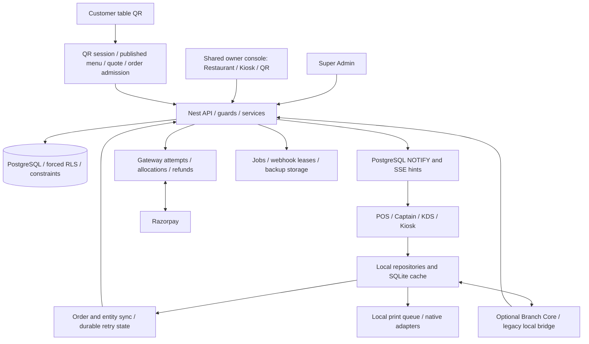
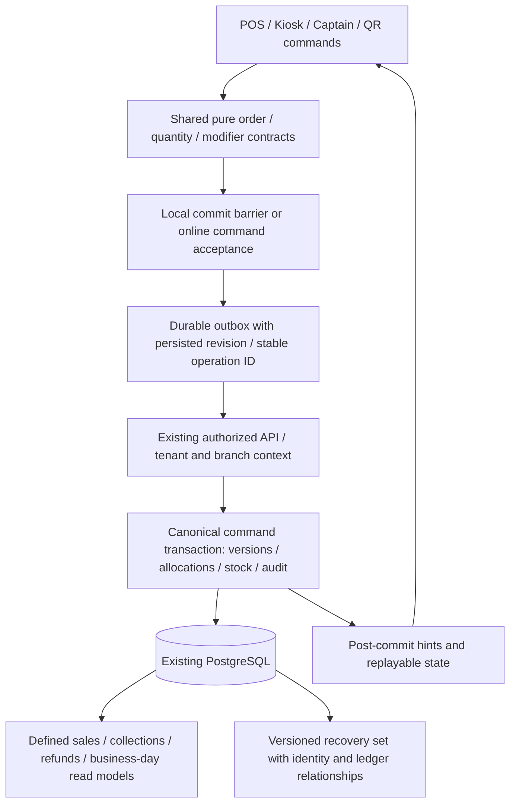

# Architecture and data ownership

## Current architecture

The operational canonical cloud record is **SyncedOrder**. The separate **Order** model under payments is an online gateway order/attempt shell; platform subscription Invoice/Payment models are another domain. These models should not be collapsed indiscriminately into one table. The improvement needed is consistent contracts and transaction boundaries between them.

## Recommended changes to the existing design

Keep the modular monolith, PostgreSQL and existing retry infrastructure. No evidence justifies adding microservices, Kafka or Kubernetes as the first repair.

## Order and payment lifecycle

Device aliases currently include DRAFT/HELD → NEW/CONFIRMED/ACCEPTED → PREPARING/COOKING → READY → SERVED/DELIVERED/COLLECTED → COMPLETED/BILLED, with cancellation/void/refund terminal aliases. The generic sync decision uses rank/revision rules; explicit QR operator actions use a narrower transition table.

Kitchen service progress and settlement are separate facts: serving food before counter payment can be legitimate. Define which screen's “Completed” means service completed versus financially closed. A proposed state machine must preserve approved pay-later/offline workflows.

Online QR creates an unpaid draft/attempt, verifies amount/currency/capture server-side, then releases the same operational order to the kitchen. Device and KDS progress use that record's version, item revisions and cursor sequence. SSE is a wake-up mechanism; it is not the sole record of delivery.

## Entity ownership matrix

| Entity | Authority / writers | Readers and propagation | Main invariant / recovery |
| --- | --- | --- | --- |
| Restaurant/branch/device identity | Authorized platform and tenant management services | Device activation, heartbeat and profile pulls | Scope derived from verified identity; revoked/changed scope denied |
| Plans, entitlements and branch allocation | Platform catalogue, entitlement service, branch-license overrides | Guards and signed/cached offline policy | Hidden UI does not authorize backend calls |
| Menu/tax/modifiers | Authorized admin entity writes and publication | Branch-aware menu snapshots and cursor pulls | Historical prices/snapshots retained; future client clocks currently complicate updates |
| Operational orders/items | Order-sync service and server QR admission; authorized device commands | POS, KDS, Captain, admin, guest status | Tenant/order ID uniqueness; locks, versions, event idempotency; source/identity must survive restore |
| Online attempts/refunds | Payment service and verified provider events | Reconciliation, fulfilment, customer status | Immutable references, validated amount/currency and guarded retries |
| Collections/returns | Authorized ledger allocation and reconciliation | Bills, analytics, cash close | Positive integer paise; collection/refund limits; auditable provenance |
| Kitchen tickets | Projection from order items, station configuration and revisions | KDS/Captain/POS, print queue | Avoid duplicate business actions; cancellations/revisions beat stale progress |
| Inventory | Shared stock movement ledger plus master definitions | Branch projection and analytics | Unique movement identity; scope and quantity validation |
| Customers/loyalty | Authorized CRM and reward workflows | POS/Kiosk/QR, entity sync | Stable customer identity and catalogued redemption; concurrent/replay acceptance still needed |
| Tables | Branch-owned entity/projection | Captain/POS/QR with branch filtering | Occupancy release must not imply payment; preserve order references |
| Print jobs / receipt delivery | Local durable job record and adapter acknowledgements | Staff diagnostics and receipt history | Queueing is distinct from successful hardware delivery |
| Analytics | Read models over persisted orders/ledger/invoices | Owner/platform dashboards and export | Explicit metric/date/source definitions; current sales report violates partial-refund semantics |

## Boundaries verified and still open

Transactions use tenant context plus sorted advisory order locks. Event claims, record writes and sync logging share the transaction; wake-ups occur after commit. Entity sequence triggers include restoration writes, ruling out an initially suspected restore-cursor defect.

The local synchronous repository API precedes asynchronous SQLite writes. Server acknowledgement and local durable commit are different boundaries; UI success currently does not establish the latter. A caught provider timeout likewise must not be treated as a verified unpaid outcome.

The broad per-restaurant entity lock and sequence counter deliberately preserve ordering but serialize writes across branches. Measure contention before replacing them; changing lock order without preserving atomicity would introduce worse failures.
