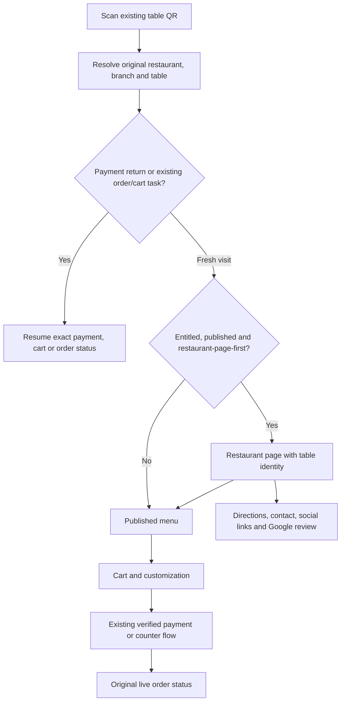

# Optional restaurant page for QR guests

Status: original source-reviewed proposal, 15 October 2026. The implemented scope, verification and remaining boundaries are recorded in [IMPLEMENTATION.md](IMPLEMENTATION.md).

## Recommendation

Add a configurable restaurant page inside the existing QR product. Each restaurant gets its own identity, photos, content and links through one shared rendering system. Keep two choices: **Direct to menu** and **Restaurant page first**. Preserve the scanned branch/table and the existing order/payment engine in both modes.

Super Admin controls whether the plan/customer/branch is entitled to this capability. The restaurant chooses whether to use it, edits its content and publishes it. Enabling a feature commercially should not automatically publish unfinished content.

## Current implementation

- `apps/qr-guest/src/App.tsx` accepts `/q/:token`, defaults to MENU and supports Menu/Cart/Checkout/Status. The initial load requests restaurant description and published menu together. A missing menu currently prevents the whole customer experience loading.
- `cloud/api/src/modules/qr/qr-settings.service.ts` and `QrBranding` already support logo, welcome heading/message, footer text, accent and licensed extras: cover, background, layout and contact message.
- `apps/restaurant-system/pos-admin/src/components/qrconsole/QrOperations.tsx` has an editor and sample Menu/Cart/Checkout style preview. The preview is separate sample markup, not the actual customer renderer.
- `qr-public.service.ts` returns restaurant name/address/city and branch name. `Branch.address` already exists, but structured branch contact/review/social information is not exposed by this response.
- `qr-capabilities.ts` includes QR_BRANDING and QR_FEEDBACK, but no separate restaurant-page capability. Existing feedback is private order feedback, not Google reviews.
- The customer footer currently contains contact/footer text and Jamanvaar attribution; it is not a structured restaurant contact footer.

## Customer flow

The restaurant page must not interrupt returning payment callbacks, tracked orders or a customer's in-progress cart. Keep View menu / Order now visible immediately and as a bottom action on phones. Returning from the menu to restaurant information must preserve the cart. Existing printed table codes remain valid when page mode changes.

A separate shareable public address, such as `/r/{restaurant-slug}/{branch-slug}`, can serve Instagram/WhatsApp/Google visitors without implying a table assignment. A restaurant-level address shows a branch chooser only when necessary. A visitor arriving without a table may browse; takeaway ordering is offered only if that branch supports it. A slug or browser-provided table number must never grant a table-order session.

Keep `/qr/` for Jamanvaar product marketing and `/qr/login/` for administrators. Do not mix restaurant pages with these routes.

## Mobile page composition

1. **Compact header:** restaurant logo/name, selected branch and scanned table when applicable; language selector where licensed.
2. **Hero:** real restaurant/food image, short welcome message, cuisine descriptor and prominent View menu / Order now.
3. **Featured dishes:** a small selection from the published branch menu. Use canonical dish photos/prices; unavailable dishes cannot be added. Details retain modifiers/allergens.
4. **About:** short restaurant story and optional gallery. Hide empty sections completely.
5. **Visit/contact:** actual branch address, opening hours, ordering availability, call and directions. Physical opening hours and online ordering hours are separate labels.
6. **Footer:** Instagram, WhatsApp, phone, address, Google review and restaurant-provided policy links where appropriate; discreet platform attribution according to the plan.

Start with three visibly distinct templates: photo-led heritage, clean cafe and contemporary dining. Share spacing, accessibility and checkout behavior. No text baked into images; all names/headings/buttons remain live editable UI. Use image focal-point controls so portrait and landscape crops keep the food visible. Avoid mandatory intro animations, carousels or full-screen promotion popups before ordering.

Do not require a map iframe, Instagram feed or external tracking scripts to load the page. Lightweight image/link cards can open those services when tapped. Compress images, reserve their dimensions and lazy-load below-the-fold galleries. Information should remain available when the menu is unpublished or ordering is paused, with an honest disabled ordering action and the restaurant's contact details.

## Controls and ownership

| Controller | Responsibilities |
| --- | --- |
| Super Admin | Grant/revoke the new capability through the existing Feature → Plan/subscription → branch restriction framework; control premium template/custom-domain availability if later introduced. Show effective entitlement, inherited settings and impact before changing it. |
| Restaurant owner / authorized QR manager | Enable page-first mode, select a permitted template, edit draft, preview, publish/unpublish and restore a published version. Managers remain limited to their authorized branch. |
| Branch configuration | Address, phone/WhatsApp, Google Maps/review link, physical hours, holiday notices and optional branch-specific photos/text. Inherit brand content unless explicitly overridden. |
| Guest | View public published content and choose an action; no admin login or unnecessary personal-data form. |

Proposed capability: `QR_RESTAURANT_PAGE` with entitlement key `qrRestaurantPage`. This is a QR feature, not a new application/device type or an extra admin login. It must work for QR-only, Restaurant Admin and Kiosk Admin customers through one shared editor and backend.

Effective display requires an active QR grant for the branch, the page capability, a published version and restaurant opt-in. If just the page capability is removed, valid QR ordering should fall back to its ordinary menu. Turning the page off must not delete saved drafts, carts or historical orders. Disabling the underlying QR product follows its existing license behavior.

Recommended defaults: existing restaurants remain Direct to menu; new entitled restaurants see a draft setup checklist and choose their entry mode explicitly. Super Admin grants access, while the restaurant publishes its page. Use a fixed set of section controls initially, keeping the owner out of a complicated free-form website builder.

| Situation | Guest experience |
| --- | --- |
| Feature unavailable, restaurant opted out or no published page | Existing menu flow |
| Feature granted, page published and page-first selected | Restaurant page, original branch/table retained |
| Existing cart or order/payment return | Resume the relevant task; restaurant information remains accessible |
| Page published but no menu or ordering temporarily closed | Restaurant information and contact remain visible; ordering action explains its unavailability |
| Page add-on revoked but base QR still active | Existing menu flow; preserve unpublished/saved content for the owner |

The existing branding endpoint currently accepts restaurant-wide changes without a branch argument. The new editor must explicitly separate owner-controlled global changes from authorized branch overrides; a branch selector alone must not imply that existing branding is branch-scoped.

## QR Admin editor

Use a single **Restaurant page** destination, with clearly labeled editing groups rather than more top-level pages:

- Page mode and template.
- Logo, colours, hero and image focal point.
- Welcome/about text and featured published dishes.
- Gallery and section visibility/order within safe template rules.
- Branch contact, hours, address, social and review links.
- Footer and existing policy links.

Show a phone preview beside the form on desktop. On a phone, offer Edit / Preview tabs. Preview must use the same rendering components, validation and responsive styles as the public page, fed with the draft; do not maintain a second mock design.

Use **Save draft → Preview → Publish**, with last-published time, unsaved-change protection and a clear scope label: Restaurant-wide or Branch X. Publishing a global change lists affected branches and exceptions. Provide preview widths around 360/390/430px and desktop, long-name testing, empty sections, closed hours and unavailable-menu states.

Preview actions can demonstrate navigation, but cannot place real orders, start payments, send messages or modify production analytics. Any shared preview URL should be authenticated or short-lived and unguessable; unpublished content is not publicly indexable. Preserve prior versions through the existing appearance-history approach, with optimistic version checks and reviewed rollback.

## Backend/data requirements

- Store structured, versioned restaurant-page drafts/publications with restaurant ownership and explicit optional branch overrides. Public responses contain only approved published fields.
- Resolve the branch/table from the existing QR code server-side; select the correct branch publication and effective entitlement there. Do not trust tenant/branch IDs from browser payloads.
- Reuse the canonical published menu and existing cart/order/payment engine. Featured menu cards must not copy prices or create a second order API.
- Separate profile loading from menu loading so information pages can work when a menu is absent. Preserve appropriate QR-disabled, revoked-code and private-table protections.
- Validate uploaded images, contact numbers and outbound URLs. Use structured fields and approved link formats; no arbitrary HTML, JavaScript or embedded scripts from the editor.
- Restaurant social links may inherit by default, but branch address/hours/map/review links must be explicitly accurate for that branch.
- Version/audit publication and invalidate caches safely so one restaurant never sees another's content. Give public pages cacheable published responses; keep previews private.
- Optional analytics should distinguish page view, menu click, call/directions/WhatsApp click and review-link click. A review-link click does not prove a Google review was submitted.

## Google review behavior

Store the restaurant's own branch-specific Google Business Profile review link and open Google's review screen. Google's instructions provide the review link/QR workflow; customers need a Google account to leave a review. Do not claim the app submitted a review, invent ratings/testimonials or show private feedback as Google reviews.

Offer the review link consistently. Keep private feedback available separately and do not condition the Google link on a positive private rating or reward a review with loyalty points.

Sources: [Create a Google review link or QR code](https://support.google.com/business/answer/16816815?hl=en), [Google's review guidance](https://support.google.com/business/answer/3474122?hl=en).

## Acceptance scenarios before release

1. QR only; POS + QR; Kiosk + QR; full-suite plan: same editor and published guest page, correct authorization.
2. Capability absent / granted / revoked, unpublished draft, owner page switch off and normal direct-menu mode.
3. Two restaurants and two branches with different profiles: no content, address, social or review-link leakage.
4. Existing table QR opens page and proceeds to menu with original table intact; old printed codes need no replacement.
5. Public share link has no table permission; branch selection and enabled takeaway mode behave correctly.
6. Existing cart, completed/active order, payment callback and browser back/refresh resume their task without unwanted landing redirects or duplicate payment/order creation.
7. Unpublished menu, paused kitchen, closed ordering hours, license/code invalidation and deleted featured dish produce truthful states.
8. Draft versus published isolation; stale simultaneous edits; publication scope; branch overrides; rollback and cache invalidation.
9. Real phone/browser layouts, long multilingual restaurant names, keyboard/screen-reader navigation, contrast and generous touch targets.
10. Missing/broken images, slow network, empty contact fields, invalid links and incorrect review-branch mapping.
11. Preview cannot create a production order, payment, message or analytics event.
12. Links open the correct external app/page and respect user action; review clicks are reported as clicks, not completed reviews.

Recommended sequence: structured profile and capability → shared public renderer and faithful preview → publish/version/scope controls → ordering entry/resume integration → browser/API regression and phone acceptance. Custom domains, live Instagram feeds and imported Google rating displays can be separate later integrations.
